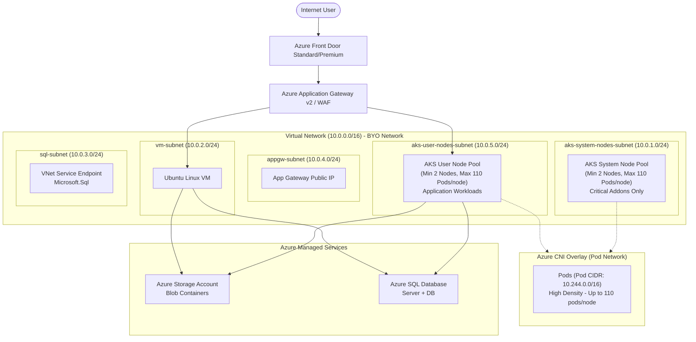
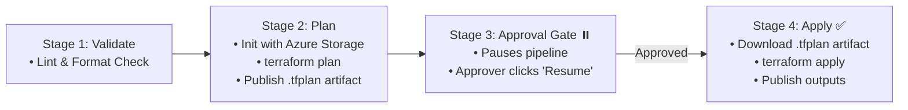
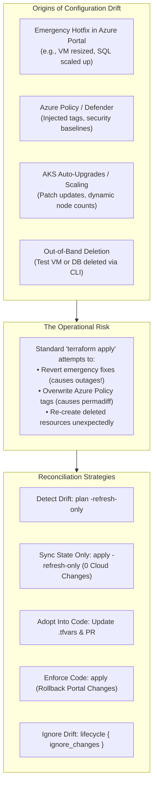
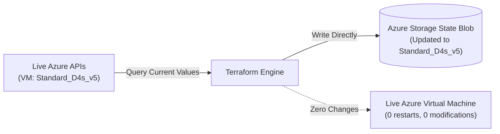
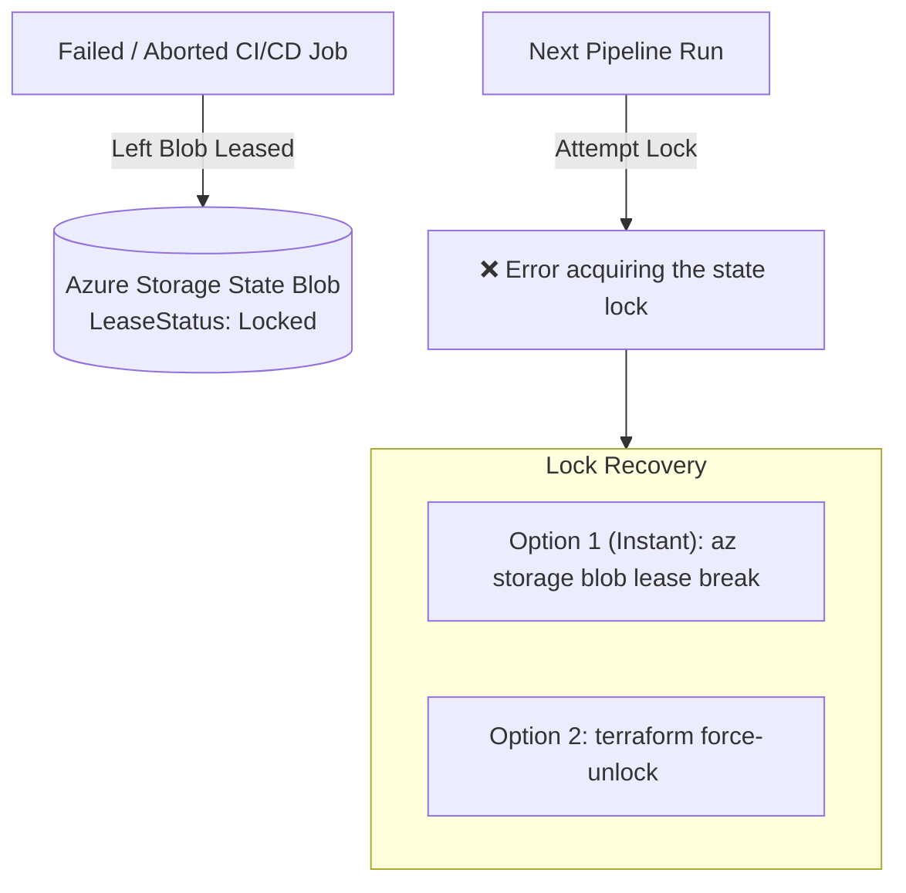
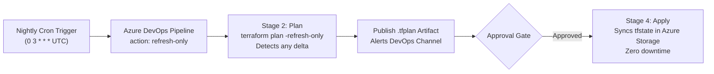

# Azure Modular Cloud Infrastructure

Production-ready Terraform modular infrastructure and Azure CLI PowerShell automation scripts for deploying an enterprise topology on Microsoft Azure.

---

## 🏗️ Architecture Overview



---

## 📂 Repository Directory Structure (Multi-Stack Isolated State)

```text
d:\[REDACTED]\Project\
├── terraform/
│   ├── modules/                         # Reusable Shared Resource Modules
│   │   ├── networking/                  # VNet, Subnets (System & User Subnets), NSGs
│   │   ├── storage/                     # Storage Account & Blob Containers
│   │   ├── compute_vm/                  # Ubuntu VM, NIC, OS Disk
│   │   ├── sql_database/                # Azure MSSQL Server & Database
│   │   └── aks/                         # AKS Cluster (Azure CNI Overlay)
│   │
│   ├── main-environments/               # STACK 1: Core Base Infrastructure (Own tfstate)
│   │   ├── main.tf                      # Deploys RG, VNet, Subnets, AKS, Base Storage, Base SQL
│   │   ├── variables.tf
│   │   ├── outputs.tf
│   │   ├── providers.tf
│   │   ├── terraform.tfstate            # ISOLATED STATE: Core infrastructure state
│   │   └── environments/
│   │       ├── dev.tfvars
│   │       ├── qa.tfvars
│   │       └── prod.tfvars
│   │
│   └── on-demand/                       # STACK 2: Transient On-Demand Workloads (Own tfstate)
│       ├── main.tf                      # Plugs into existing VNet via data sources
│       ├── variables.tf
│       ├── outputs.tf
│       ├── providers.tf
│       ├── terraform.tfstate            # ISOLATED STATE: On-demand workloads state
│       └── on-demand.tfvars             # On-demand parameters
│
└── scripts/
    ├── deploy-terraform-env.ps1         # Runs Main Environment (Dev, QA, Prod)
    ├── deploy-on-demand.ps1             # Runs On-Demand Stack (Deploy/Destroy without touching Core)
    ├── deploy-app-gateway.ps1           # Application Gateway CLI automation
    └── deploy-azure-front-door.ps1      # Azure Front Door CLI automation
```

---

## ☸️ AKS Architecture Highlights

### 1. Dedicated System and User Pools
- **System Node Pool (`systempool`)**:
  - Attached to dedicated BYO subnet: `aks-system-nodes-subnet` (`10.0.1.0/24`)
  - Configured with `only_critical_addons_enabled = true` so user workloads do not preempt core Kubernetes services (CoreDNS, metrics-server, etc.).
  - Autoscaling: Minimum 2 nodes (`min_count = 2`).
  - Max Pods per node: 110 pods (`max_pods = 110`).
- **User Node Pool (`userpool`)**:
  - Attached to dedicated BYO subnet: `aks-user-nodes-subnet` (`10.0.5.0/24`)
  - Configured in `mode = "User"` specifically for application pods.
  - Autoscaling: Minimum 2 nodes (`min_count = 2`, default capacity 2-6 nodes).
  - Max Pods per node: 110 pods (`max_pods = 110`).

### 2. Azure CNI Overlay with BYO Network
- **Node IP allocation**: VM scale set nodes receive private IP addresses directly from your BYO VNet subnets (`10.0.1.0/24` and `10.0.5.0/24`).
- **Pod IP allocation**: Pods receive private IPs from an isolated private overlay space (`10.244.0.0/16`), preventing VNet IP address exhaustion while allowing maximum pod density (up to 110 pods per node).
- **Service CIDR**: `172.16.0.0/16` with internal CoreDNS at `172.16.0.10`.

---

## 🌍 Part 1: Deploying Main Environments (Core Base Infrastructure)

The **Main Environments** stack ([`terraform/main-environments/`](file:///d:/[REDACTED]/Project/terraform/main-environments/)) manages your foundational Azure topology: Resource Group, VNet with dedicated node subnets, AKS Cluster (System & User pools), primary SQL database, and base storage.

### 1. Environment Configurations
* [`environments/dev.tfvars`](file:///d:/[REDACTED]/Project/terraform/main-environments/environments/dev.tfvars): Cost-optimized (VNet: `10.10.0.0/16`, 2 AKS system nodes, 2 AKS user nodes, S0 SQL DB)
* [`environments/qa.tfvars`](file:///d:/[REDACTED]/Project/terraform/main-environments/environments/qa.tfvars): Staging scale (VNet: `10.20.0.0/16`, ZRS storage, S1 SQL DB, 2-6 user nodes)
* [`environments/prod.tfvars`](file:///d:/[REDACTED]/Project/terraform/main-environments/environments/prod.tfvars): High-Availability (VNet: `10.30.0.0/16`, GRS storage, GP_Gen5_2 SQL DB, 3-12 user nodes, private VM, SSH keys only)

### 2. Method A: Automated PowerShell Runner (Recommended)
Use [`deploy-terraform-env.ps1`](file:///d:/[REDACTED]/Project/scripts/deploy-terraform-env.ps1) with automated workspace/state isolation:

```powershell
# Plan DEV
& "d:\[REDACTED]\Project\scripts\deploy-terraform-env.ps1" -Environment dev -Action plan

# Apply DEV
& "d:\[REDACTED]\Project\scripts\deploy-terraform-env.ps1" -Environment dev -Action apply

# Plan QA
& "d:\[REDACTED]\Project\scripts\deploy-terraform-env.ps1" -Environment qa -Action plan

# Apply PROD (Prompts for mandatory 'PROD' confirmation before applying)
& "d:\[REDACTED]\Project\scripts\deploy-terraform-env.ps1" -Environment prod -Action apply

# Read Outputs for DEV
& "d:\[REDACTED]\Project\scripts\deploy-terraform-env.ps1" -Environment dev -Action output
```

### 3. Method B: Direct Terraform CLI in `main-environments/`

```powershell
Set-Location -Path "d:\[REDACTED]\Project\terraform\main-environments"

# Initialize with Azure Blob Remote State (or local state)
terraform init `
    -backend-config="resource_group_name=rg-terraform-state-mgmt" `
    -backend-config="storage_account_name=sttfstatemgmt2026" `
    -backend-config="container_name=tfstate" `
    -backend-config="key=main-environments/dev.terraform.tfstate" `
    -reconfigure

# Review and Apply
terraform plan -var-file="environments/dev.tfvars" -out="dev.tfplan"
terraform apply "dev.tfplan"
```

---

## 🎯 Part 2: Deploying On-Demand Workloads (Isolated State & Catalog)

The **On-Demand Stack** ([`terraform/on-demand/`](file:///d:/[REDACTED]/Project/terraform/on-demand/)) allows developers and teams to deploy transient or ad-hoc VMs, SQL DBs, and Storage accounts that **plug into the existing VNet** without touching the core AKS cluster or base state.

### 1. Workload Catalog Templates
Configurations are version-controlled in [`terraform/on-demand/workloads/`](file:///d:/[REDACTED]/Project/terraform/on-demand/workloads/) so they are 100% reproducible:
* [`workloads/pr-template.tfvars`](file:///d:/[REDACTED]/Project/terraform/on-demand/workloads/pr-template.tfvars): Lightweight VM + SQL DB for Pull Request / feature testing.
* [`workloads/analytics-heavy.tfvars`](file:///d:/[REDACTED]/Project/terraform/on-demand/workloads/analytics-heavy.tfvars): High-compute 8 vCPU VM + high-capacity storage for data science.

### 2. State & Governance Naming Standards
* **Azure Blob State Key:** `on-demand/{environment}-{workloadId}.terraform.tfstate`
  * Example: `on-demand/dev-pr-104.terraform.tfstate`
  * Example: `on-demand/dev-analytics-heavy.terraform.tfstate`
* **Resource Governance Tags:** Automatically stamped on all on-demand resources:
  * `WorkloadId` (e.g. `pr-104`)
  * `PRNumber` (e.g. `104`)
  * `Requester` (e.g. `[REDACTED]`)
  * `ExpirationDate` (e.g. `2026-10-31`)
  * `ManagedBy = Terraform-OnDemand`

### 3. Method A: Automated PowerShell Runner (`deploy-on-demand.ps1`)

```powershell
# Deploy a Pull Request test environment (PR #104)
& "d:\[REDACTED]\Project\scripts\deploy-on-demand.ps1" `
    -WorkloadId "pr-104" `
    -VarFile "workloads/pr-template.tfvars" `
    -Action apply

# Deploy a Heavy Analytics workload
& "d:\[REDACTED]\Project\scripts\deploy-on-demand.ps1" `
    -WorkloadId "analytics-heavy" `
    -VarFile "workloads/analytics-heavy.tfvars" `
    -Action apply

# Clean up / Teardown ONLY PR #104 (Leaves VNet, AKS, and other workloads 100% intact!)
& "d:\[REDACTED]\Project\scripts\deploy-on-demand.ps1" `
    -WorkloadId "pr-104" `
    -Action destroy
```

### 4. Method B: Direct Terraform CLI in `on-demand/`

```powershell
Set-Location -Path "d:\[REDACTED]\Project\terraform\on-demand"

# Initialize with isolated workload state key
terraform init `
    -backend-config="resource_group_name=rg-terraform-state-mgmt" `
    -backend-config="storage_account_name=sttfstatemgmt2026" `
    -backend-config="container_name=tfstate" `
    -backend-config="key=on-demand/dev-pr-104.terraform.tfstate" `
    -reconfigure

# Plan and Apply
terraform plan -var-file="workloads/pr-template.tfvars" -var="workload_id=pr-104" -out="pr104.tfplan"
terraform apply "pr104.tfplan"
```

### 5. Managing State Across Pull Requests & Merges

In Terraform, state files are **never tied to a Git branch or PR number**—Terraform locates resources strictly by the **Backend State Key** (`key=...`) configured in Azure Storage.

#### Scenario A: Modifying an Existing On-Demand Workload (e.g. PR-104)
If you already deployed a VM under `pr-104` and need to resize it (e.g., from `Standard_B2s` to `Standard_D4s_v5`):
1. Update `vm_size = "Standard_D4s_v5"` in `workloads/pr-template.tfvars` (or `workloads/pr-104.tfvars`).
2. Run the deployment with `workload_id = "pr-104"`:
   * **In Pipeline:** Set parameter `onDemandWorkloadId: pr-104` and `action: apply`.
   * **In PowerShell:**
     ```powershell
     & "d:\[REDACTED]\Project\scripts\deploy-on-demand.ps1" -WorkloadId "pr-104" -Action apply
     ```
   * *Result:* Terraform re-opens `on-demand/dev-pr-104.terraform.tfstate`, detects the existing VM in Azure, and performs an in-place resize without recreating the resource.

#### Scenario B: Follow-up PR (PR-105) Modifying Resources Created by PR-104
If PR 104 was merged into `main` and a new PR (PR 105) needs to update or add to the existing VM:
* In PR 105, keep `workload_id = "pr-104"` in your `.tfvars` file (you can still set `pr_number = "105"` for audit tracking).
* Run the pipeline with `onDemandWorkloadId: pr-104`.
* Terraform loads `on-demand/dev-pr-104.terraform.tfstate`, reads the existing resources, and applies PR 105's changes to them.

#### Scenario C: Recommended Best Practice — Feature-Based Workload Naming
Instead of naming workloads after ephemeral PR numbers (`pr-104`), name workloads after the **Feature or Service** if they are intended to persist across multiple PRs:

| Workflow Type | Workload ID Pattern | State Key in Azure Storage | Lifecycle |
| :--- | :--- | :--- | :--- |
| **Ephemeral PR Test** | `pr-104` | `on-demand/dev-pr-104.terraform.tfstate` | Destroyed when PR is merged |
| **Persistent Feature** | `feature-auth` or `analytics-poc` | `on-demand/dev-feature-auth.terraform.tfstate` | Lives across PRs; updated by any PR |

* PR 104 creates the feature: `workload_id = "feature-auth"`
* PR 105 modifies the feature: `workload_id = "feature-auth"` (connects to the identical state file seamlessly)

#### Scenario D: Promoting or Renaming a State File in Azure Storage
If you deployed under `pr-104` and now want to rename that state file so it becomes a permanent shared workload called `data-analytics`:

```powershell
# Copy the state file to a new permanent key:
az storage blob copy start `
    --account-name "sttfstatemgmt2026" `
    --destination-container "tfstate" `
    --destination-blob "on-demand/dev-data-analytics.terraform.tfstate" `
    --source-container "tfstate" `
    --source-blob "on-demand/dev-pr-104.terraform.tfstate" `
    --auth-mode login

# (Optional) Delete the old temporary PR blob:
az storage blob delete `
    --account-name "sttfstatemgmt2026" `
    --container-name "tfstate" `
    --name "on-demand/dev-pr-104.terraform.tfstate" `
    --auth-mode login
```

---

## ⚡ Part 3: Application Gateway Deployment (PowerShell CLI)

You can run the automated script or execute the commands step-by-step.

### Option A: Run the Script
```powershell
& "d:\[REDACTED]\Project\scripts\deploy-app-gateway.ps1" `
    -ResourceGroup "rg-myapp-dev-eastus" `
    -Location "eastus" `
    -VNetName "myapp-vnet-dev" `
    -SubnetName "appgw-subnet" `
    -AppGatewayName "myapp-appgw-dev" `
    -PublicIpName "myapp-appgw-pip" `
    -Sku "Standard_v2" `
    -MinCapacity 1 `
    -MaxCapacity 3 `
    -BackendServers @("10.0.1.10", "10.0.2.4")
```

### Option B: Step-by-Step CLI Commands in PowerShell

```powershell
# 1. Define Variables
$RG            = "rg-myapp-dev-eastus"
$Location      = "eastus"
$VNetName      = "myapp-vnet-dev"
$SubnetName    = "appgw-subnet"
$PublicIpName  = "myapp-appgw-pip"
$AppGwName     = "myapp-appgw-dev"

# 2. Create Public IP (Standard SKU Required)
az network public-ip create `
    --resource-group $RG `
    --name $PublicIpName `
    --location $Location `
    --sku Standard `
    --allocation-method Static

# 3. Create Application Gateway with Autoscale
az network application-gateway create `
    --resource-group $RG `
    --name $AppGwName `
    --location $Location `
    --sku Standard_v2 `
    --capacity 1 `
    --min-capacity 1 `
    --vnet-name $VNetName `
    --subnet $SubnetName `
    --public-ip-address $PublicIpName `
    --frontend-port 80 `
    --http-settings-port 80 `
    --http-settings-protocol Http `
    --http-settings-cookie-based-affinity Disabled `
    --servers "10.0.1.10" "10.0.2.4" `
    --priority 100

# 4. Set Autoscaling Upper Limit
az network application-gateway autoscale-configuration update `
    --resource-group $RG `
    --gateway-name $AppGwName `
    --min-capacity 1 `
    --max-capacity 4

# 5. Add Custom Health Probe
az network application-gateway probe create `
    --resource-group $RG `
    --gateway-name $AppGwName `
    --name "hp-default-health" `
    --protocol Http `
    --path "/healthz" `
    --interval 30 `
    --timeout 30 `
    --threshold 3 `
    --host-name-from-http-settings true `
    --match-status-codes "200-399"

# 6. Associate Probe with HTTP Settings
az network application-gateway http-settings update `
    --resource-group $RG `
    --gateway-name $AppGwName `
    --name "appGatewayBackendHttpSettings" `
    --probe "hp-default-health" `
    --timeout 60

# 7. Retrieve the Frontend Public IP Address
az network public-ip show `
    --resource-group $RG `
    --name $PublicIpName `
    --query "ipAddress" `
    --output tsv
```

---

## 🌐 Part 4: Azure Front Door (AFD) Deployment (PowerShell CLI)

Azure Front Door standard/premium provides global L7 routing, edge caching, and SSL offloading.

### Option A: Run the Script
```powershell
& "d:\[REDACTED]\Project\scripts\deploy-azure-front-door.ps1" `
    -ResourceGroup "rg-myapp-dev-eastus" `
    -ProfileName "myapp-afd-dev" `
    -Sku "Standard_AzureFrontDoor" `
    -EndpointName "myapp-frontdoor-ep" `
    -OriginGroupName "og-appgw-backends" `
    -OriginName "origin-appgw" `
    -OriginHostName "<YOUR_APP_GATEWAY_PUBLIC_IP_OR_DNS>" `
    -RouteName "route-default"
```

### Option B: Step-by-Step CLI Commands in PowerShell

```powershell
# 1. Define Variables
$RG              = "rg-myapp-dev-eastus"
$ProfileName     = "myapp-afd-dev"
$EndpointName    = "myapp-frontdoor-ep"
$OriginGroupName = "og-appgw-backends"
$OriginName      = "origin-appgw"
$OriginHost      = "20.120.45.10" # Replace with your App Gateway Public IP or custom FQDN
$RouteName       = "route-all-traffic"

# 2. Create Azure Front Door Profile
az afd profile create `
    --resource-group $RG `
    --profile-name $ProfileName `
    --sku Standard_AzureFrontDoor

# 3. Create Front Door Endpoint
az afd endpoint create `
    --resource-group $RG `
    --profile-name $ProfileName `
    --endpoint-name $EndpointName `
    --enabled-state Enabled

# 4. Create Origin Group with Health Probes
az afd origin-group create `
    --resource-group $RG `
    --profile-name $ProfileName `
    --origin-group-name $OriginGroupName `
    --probe-request-type GET `
    --probe-protocol Http `
    --probe-interval-in-seconds 30 `
    --probe-path "/healthz" `
    --sample-size 4 `
    --successful-samples-required 3 `
    --additional-latency-in-milliseconds 50

# 5. Add Origin (App Gateway Backend)
az afd origin create `
    --resource-group $RG `
    --profile-name $ProfileName `
    --origin-group-name $OriginGroupName `
    --origin-name $OriginName `
    --host-name $OriginHost `
    --http-port 80 `
    --https-port 443 `
    --origin-host-header $OriginHost `
    --priority 1 `
    --weight 1000 `
    --enabled-state Enabled `
    --enforce-certificate-name-check false

# 6. Create Routing Rule with Automatic HTTPS Redirect
az afd route create `
    --resource-group $RG `
    --profile-name $ProfileName `
    --endpoint-name $EndpointName `
    --route-name $RouteName `
    --origin-group $OriginGroupName `
    --supported-protocols Http Https `
    --link-to-default-domain Enabled `
    --forwarding-protocol MatchRequest `
    --https-redirect Enabled `
    --patterns-to-match "/*"

# 7. Get the Public Azure Front Door Endpoint FQDN
az afd endpoint show `
    --resource-group $RG `
    --profile-name $ProfileName `
    --endpoint-name $EndpointName `
    --query "hostName" `
    --output tsv
```

---

## 🚀 Part 5: Azure DevOps CI/CD Pipeline Deployment

The repository includes a production-grade Azure DevOps pipeline at [`azure-pipelines.yml`](file:///d:/[REDACTED]/Project/azure-pipelines.yml).

### 1. Step 1: Provision the Azure Storage Account for `tfstate`
Run the included PowerShell script to create your dedicated state storage with Blob Versioning and Soft Delete:

```powershell
& "d:\[REDACTED]\Project\scripts\setup-tfstate-storage.ps1" `
    -ResourceGroupName "rg-terraform-state-mgmt" `
    -Location "eastus" `
    -ContainerName "tfstate"
```

### 2. Step 2: Configure Azure DevOps Service Connection
1. In Azure DevOps, go to **Project Settings** > **Service connections**.
2. Click **New service connection** > **Azure Resource Manager**.
3. Select **Workload Identity Federation (automatic)** or **Service Principal**.
4. Name the connection: `Azure-DevOps-Service-Connection`.
5. Grant permission to all pipelines.

### 3. Step 3: Configure Azure DevOps Environments & Approvals
1. In Azure DevOps, navigate to **Pipelines** > **Environments**.
2. Create environments named: `dev`, `qa`, and `prod`.
3. On the `prod` environment, click **Approvals and checks** > **Approvals** and add your Lead DevOps / Architect team as required approvers.

### 4. Step 4: Run the Pipeline with Interactive Parameters
When triggering the pipeline in Azure DevOps, select the runtime parameters:
* **Select Stack to Deploy**: `main-environments` or `on-demand`
* **Target Environment**: `dev`, `qa`, or `prod`
* **On-Demand Workload Identifier / PR Number**: `pr-104`, `analytics-heavy`, etc. (binds to cataloged `.tfvars` and isolated state key)
* **Pipeline Action**: `plan`, `apply`, `destroy`, or `refresh-only`
* **Require In-Pipeline Manual Approval Gate**: `true` / `false`



---

## 🔄 Part 6: Managing Configuration Drift & Updating State (Without Modifying Cloud Resources)

In enterprise cloud environments, **Configuration Drift** occurs when actual Azure infrastructure diverges from what is recorded in Terraform state or defined in your Git repository.



---

### 📋 Quick Reference: Commands Comparison Matrix

| Scenario / Task | Main Environments (`terraform/main-environments/`) | On-Demand Workloads (`terraform/on-demand/`) |
| :--- | :--- | :--- |
| **Detect Drift (Audit Only)** | `.\scripts\deploy-terraform-env.ps1 -Environment dev -Action plan`<br>`terraform plan -refresh-only -var-file="environments/dev.tfvars"` | `.\scripts\deploy-on-demand.ps1 -WorkloadId "pr-104" -Action plan`<br>`terraform plan -refresh-only -var-file="workloads/pr-template.tfvars" -var="workload_id=pr-104"` |
| **Update State (0 Cloud Changes)** | `.\scripts\deploy-terraform-env.ps1 -Environment dev -Action refresh-only`<br>`terraform apply -refresh-only -var-file="environments/dev.tfvars"` | `.\scripts\deploy-on-demand.ps1 -WorkloadId "pr-104" -Action refresh-only`<br>`terraform apply -refresh-only -var-file="workloads/pr-template.tfvars" -var="workload_id=pr-104"` |
| **Targeted Single-Resource Refresh** | `terraform apply -refresh-only -target="module.compute_vm.azurerm_linux_virtual_machine.vm[0]" -var-file="environments/dev.tfvars"` | `terraform apply -refresh-only -target="module.compute_vm.azurerm_linux_virtual_machine.vm[0]" -var-file="workloads/pr-template.tfvars" -var="workload_id=pr-104"` |
| **Revert Cloud Back to Git Code** | `.\scripts\deploy-terraform-env.ps1 -Environment dev -Action apply`<br>`terraform apply -var-file="environments/dev.tfvars"` | `.\scripts\deploy-on-demand.ps1 -WorkloadId "pr-104" -Action apply`<br>`terraform apply -var-file="workloads/pr-template.tfvars" -var="workload_id=pr-104"` |
| **Drop Deleted Resource from State** | `terraform state rm "module.compute_vm.azurerm_linux_virtual_machine.vm[0]"` | `terraform state rm "module.compute_vm.azurerm_linux_virtual_machine.vm[0]"` |
| **Import Out-of-Band Resource** | `terraform import -var-file="environments/dev.tfvars" "module.sql_database.azurerm_mssql_database.db[0]" "<AZURE_RESOURCE_ID>"` | `terraform import -var-file="workloads/pr-template.tfvars" -var="workload_id=pr-104" "module.compute_vm.azurerm_linux_virtual_machine.vm[0]" "<AZURE_RESOURCE_ID>"` |
| **Unlock Stuck State (Break Blob Lease)** | `az storage blob lease break -c tfstate -b "main-environments/dev.terraform.tfstate" --account-name sttfstatemgmt2026 --auth-mode login` | `az storage blob lease break -c tfstate -b "on-demand/dev-pr-104.terraform.tfstate" --account-name sttfstatemgmt2026 --auth-mode login` |

---

### 1. Scenario 1: Detecting Configuration Drift (Non-Destructive Read-Only Audit)

**Problem:** You suspect someone made changes in the Azure Portal or via Azure CLI, or you want to verify compliance without touching resources or modifying the remote state.

#### A. Main Environments (Dev / QA / Prod)
```powershell
# Method 1: Using automated runner
& "d:\[REDACTED]\Project\scripts\deploy-terraform-env.ps1" -Environment dev -Action plan

# Method 2: Direct Terraform CLI in main-environments/
Set-Location -Path "d:\[REDACTED]\Project\terraform\main-environments"
terraform plan -refresh-only -var-file="environments/dev.tfvars"
```

#### B. On-Demand Workloads (e.g. PR-104 / Analytics)
```powershell
# Method 1: Using automated runner
& "d:\[REDACTED]\Project\scripts\deploy-on-demand.ps1" -WorkloadId "pr-104" -VarFile "workloads/pr-template.tfvars" -Action plan

# Method 2: Direct Terraform CLI in on-demand/
Set-Location -Path "d:\[REDACTED]\Project\terraform\on-demand"
terraform plan -refresh-only -var-file="workloads/pr-template.tfvars" -var="workload_id=pr-104"
```

#### What You See in the Output:
```text
Note: Objects have changed outside of Terraform

Terraform detected the following changes made outside of Terraform since the last "terraform apply":

  # module.compute_vm.azurerm_linux_virtual_machine.vm[0] has changed
  ~ size = "Standard_B2s" -> "Standard_D4s_v5"

This is a refresh-only plan. No physical resources will be modified if you apply this plan.
```

---

### 2. Scenario 2: Updating `tfstate` Without Touching Azure Cloud Resources (`-refresh-only`)

**Problem:** An authorized emergency change was executed in Azure (e.g. VM upsized, SQL database scaled up, NSG rule adjusted). You want Terraform state to record this reality **without modifying, restarting, or touching any running cloud resource**.



#### A. Main Environments
```powershell
# Automated Runner
& "d:\[REDACTED]\Project\scripts\deploy-terraform-env.ps1" -Environment dev -Action refresh-only

# Direct CLI
Set-Location -Path "d:\[REDACTED]\Project\terraform\main-environments"
terraform apply -refresh-only -var-file="environments/dev.tfvars" -auto-approve
```

#### B. On-Demand Workloads
```powershell
# Automated Runner
& "d:\[REDACTED]\Project\scripts\deploy-on-demand.ps1" -WorkloadId "pr-104" -VarFile "workloads/pr-template.tfvars" -Action refresh-only

# Direct CLI
Set-Location -Path "d:\[REDACTED]\Project\terraform\on-demand"
terraform apply -refresh-only -var-file="workloads/pr-template.tfvars" -var="workload_id=pr-104" -auto-approve
```

#### C. Targeted Refresh (Only Update One Specific Resource)
```powershell
# Refresh ONLY the VM in Main Environments:
terraform apply -refresh-only `
    -target="module.compute_vm.azurerm_linux_virtual_machine.vm[0]" `
    -var-file="environments/dev.tfvars"

# Refresh ONLY the SQL DB in On-Demand:
terraform apply -refresh-only `
    -target="module.sql_database.azurerm_mssql_database.db[0]" `
    -var-file="workloads/pr-template.tfvars" `
    -var="workload_id=pr-104"
```

> [!NOTE]
> Terraform explicitly outputs:
> `Apply complete! Resources: 0 added, 0 changed, 0 destroyed.`
> Only the state JSON in Azure Blob Storage is updated.

---

### 3. Scenario 3: Complete Workflow to Reconcile Git Code After Drift

**Problem:** If you refresh `tfstate` without updating `.tfvars`, the next developer who runs `terraform apply` will inadvertently **revert** the manual fix back to old code values.

#### 4-Step Reconcile Lifecycle:
1. **Refresh State**: Run `apply -refresh-only` (as shown in Scenario 2).
2. **Update Git Code (`.tfvars`)**:
   - For Main Environments: Open [`terraform/main-environments/environments/dev.tfvars`](file:///d:/[REDACTED]/Project/terraform/main-environments/environments/dev.tfvars) and update:
     ```hcl
     vm_size = "Standard_D4s_v5"
     ```
   - For On-Demand Workloads: Open [`terraform/on-demand/workloads/pr-template.tfvars`](file:///d:/[REDACTED]/Project/terraform/on-demand/workloads/pr-template.tfvars) and update:
     ```hcl
     vm_size = "Standard_D4s_v5"
     ```
3. **Verify Git Code Matches State**:
   ```powershell
   # Main Environments:
   terraform plan -var-file="environments/dev.tfvars"

   # On-Demand:
   terraform plan -var-file="workloads/pr-template.tfvars" -var="workload_id=pr-104"
   ```
   *Expected Confirmation Output:*
   ```text
   No changes. Your infrastructure matches the configuration.
   ```
4. **Commit & Push to Git**: Create a PR with title `fix: reconcile VM size drift from incident #402`.

---

### 4. Scenario 4: Reverting Unauthorized Drift (Enforcing Git as Single Source of Truth)

**Problem:** An engineer improperly edited a Network Security Group (NSG) rule or opened an unauthorized port in the Azure Portal. You want to **undo their portal edits** and force Azure back to the exact secure configuration defined in Git.

#### Fix:
Do **NOT** run `-refresh-only`. Run standard `plan` and `apply`:

```powershell
# Main Environments:
Set-Location -Path "d:\[REDACTED]\Project\terraform\main-environments"
terraform plan -var-file="environments/dev.tfvars" -out="revert.tfplan"
terraform apply "revert.tfplan"

# On-Demand:
Set-Location -Path "d:\[REDACTED]\Project\terraform\on-demand"
terraform plan -var-file="workloads/pr-template.tfvars" -var="workload_id=pr-104" -out="revert.tfplan"
terraform apply "revert.tfplan"
```
*Result:* Terraform calculates the delta between Git and Azure, and automatically strips out the unauthorized portal change.

---

### 5. Scenario 5: Handling Out-of-Band Deleted Resources ("Ghost State")

**Problem:** A developer deleted a temporary VM or SQL database directly in the Azure Portal without using Terraform. Now Terraform errors or still thinks the resource exists in `tfstate`.

#### Fix Option A: Clean Automated State Sync (Recommended)
```powershell
# In on-demand/ or main-environments/:
terraform apply -refresh-only -var-file="workloads/pr-template.tfvars" -var="workload_id=pr-104"
```
*Terraform queries Azure, receives HTTP 404 Not Found, and automatically purges the deleted resource from `tfstate` without failing.*

#### Fix Option B: Manual State Removal via `terraform state rm`
If you need to instantly remove a resource record from state without calling Azure APIs:

```powershell
# 1. List all resources currently in state:
terraform state list

# 2. Remove the specific deleted resource from state:
# For VM:
terraform state rm "module.compute_vm.azurerm_linux_virtual_machine.vm[0]"
terraform state rm "module.compute_vm.azurerm_network_interface.nic[0]"

# For SQL DB:
terraform state rm "module.sql_database.azurerm_mssql_database.db[0]"
```

---

### 6. Scenario 6: Broken State Locks & Stuck Azure Blob Leases (Deadlock Recovery)

**Problem:** A CI/CD pipeline crashed, timed out, or network dropped during an apply. Now subsequent runs fail with:
`Error: Error acquiring the state lock: blob is already leased`.



#### Step-by-Step Fix:

#### Method A: Instant Azure CLI Lease Break (No Lock ID Needed - Most Reliable)
```powershell
# For Main Environments (dev):
az storage blob lease break `
    --account-name "sttfstatemgmt2026" `
    --container-name "tfstate" `
    --blob-name "main-environments/dev.terraform.tfstate" `
    --auth-mode login

# For On-Demand Workload (pr-104):
az storage blob lease break `
    --account-name "sttfstatemgmt2026" `
    --container-name "tfstate" `
    --blob-name "on-demand/dev-pr-104.terraform.tfstate" `
    --auth-mode login
```

#### Method B: Native Terraform Force Unlock
```powershell
# Using the Lock ID printed in the Terraform error message:
terraform force-unlock -force "b991cf92-491a-96e4-44b7-991f810df627"
```

Once unlocked, immediately run `apply -refresh-only` to ensure the state reflects current Azure reality.

---

### 7. Scenario 7: Out-of-Band Resource Creation Brought Under Terraform (`terraform import`)

**Problem:** An engineer created an Azure SQL Database or Virtual Machine manually via Azure Portal during an urgent migration. You want to bring it under Terraform management **without destroying or recreating it**.

#### Step-by-Step Fix:

1. **Write the resource code** in your `.tfvars` or `.tf` file:
   In [`terraform/on-demand/workloads/pr-template.tfvars`](file:///d:/[REDACTED]/Project/terraform/on-demand/workloads/pr-template.tfvars):
   ```hcl
   enable_sql = true
   sql_db_name = "sqldb-emergency-fix"
   ```

2. **Retrieve the Azure Resource ID from Azure CLI**:
   ```powershell
   $DbId = az sql db show `
       --resource-group "rg-myapp-dev-eastus" `
       --server "sql-myapp-dev-eastus" `
       --name "sqldb-emergency-fix" `
       --query "id" -o tsv
   ```

3. **Import into Terraform State**:
   ```powershell
   # In on-demand/:
   terraform import `
       -var-file="workloads/pr-template.tfvars" `
       -var="workload_id=pr-104" `
       "module.sql_database.azurerm_mssql_database.db[0]" `
       "$DbId"

   # In main-environments/:
   terraform import `
       -var-file="environments/dev.tfvars" `
       "module.sql_database.azurerm_mssql_database.db[0]" `
       "$DbId"
   ```

4. **Verify Zero Changes**:
   ```powershell
   terraform plan -var-file="workloads/pr-template.tfvars" -var="workload_id=pr-104"
   ```
   *Terraform outputs: `No changes. Your infrastructure matches the configuration.`*

---

### 8. Scenario 8: Azure Policy / Security Auto-Tagging "Permadiff" (Infinite Drift)

**Problem:** Microsoft Defender for Cloud or Azure Governance Policy automatically assigns tags (e.g. `PolicyAssignmentId`, `CostCenter`, `Owner`) to all Azure resources. Every time Terraform runs, it detects drift:
`~ tags = { - "PolicyAssignmentId" = "..." }` and attempts to delete them. Next time Azure Policy runs, it adds them back. This creates an **infinite drift cycle (permadiff)**.

#### Fix: Permanent Lifecycle Ignore in Terraform Modules
In your module definitions (e.g. [`terraform/modules/compute_vm/main.tf`](file:///d:/[REDACTED]/Project/terraform/modules/compute_vm/main.tf) or [`terraform/modules/storage/main.tf`](file:///d:/[REDACTED]/Project/terraform/modules/storage/main.tf)):

```hcl
resource "azurerm_linux_virtual_machine" "vm" {
  count = var.enable_vm ? 1 : 0
  # ... VM attributes ...

  lifecycle {
    # Ignore tags injected out-of-band by Azure Policy or Defender
    ignore_changes = [
      tags["PolicyAssignmentId"],
      tags["CostCenter"],
      tags["SecurityContact"],
      tags["CreatedByAzurePolicy"]
    ]
  }
}
```

Or to ignore all tags that are not explicitly defined in your `.tfvars`:
```hcl
  lifecycle {
    ignore_changes = [ tags ]
  }
```

---

### 9. Scenario 9: AKS Kubernetes Auto-Upgrade & Node Image Drift

**Problem:** Azure AKS has automatic cluster or node image upgrades enabled. Azure automatically bumped the Kubernetes patch version (e.g. from `1.29.2` to `1.29.4`) or applied a weekly node OS VHD security patch.
Running a standard `terraform apply` will try to **downgrade AKS back to `1.29.2`**, causing disruptive node replacement and pod downtime.

#### Step-by-Step Fix:

1. **Inspect Live AKS Version via Azure CLI**:
   ```powershell
   az aks show `
       --resource-group "rg-myapp-dev-eastus" `
       --name "aks-myapp-dev-eastus" `
       --query "{CurrentK8s:currentKubernetesVersion, NodeImageVersion:agentPoolProfiles[0].nodeImageVersion}" `
       -o table
   ```

2. **Sync State with Live Version (Zero Downtime)**:
   ```powershell
   Set-Location -Path "d:\[REDACTED]\Project\terraform\main-environments"
   terraform apply -refresh-only -var-file="environments/dev.tfvars" -auto-approve
   ```

3. **Update Code in `dev.tfvars`**:
   Open [`terraform/main-environments/environments/dev.tfvars`](file:///d:/[REDACTED]/Project/terraform/main-environments/environments/dev.tfvars):
   ```hcl
   aks_kubernetes_version = "1.29.4"
   ```

4. **Verify In-Sync**:
   ```powershell
   terraform plan -var-file="environments/dev.tfvars"
   # Output: No changes.
   ```

---

### 10. Scenario 10: Base VNet / Subnet Reconfiguration Impacting On-Demand Workloads

**Problem:** The core platform team updated the VNet or recreated subnets in `main-environments`.
The on-demand stack ([`terraform/on-demand/main.tf`](file:///d:/[REDACTED]/Project/terraform/on-demand/main.tf)) uses `data "azurerm_subnet"` to discover the existing VNet subnets. Because `tfstate` still has the old cached subnet ARM resource ID, deploying an on-demand VM throws an error: `SubnetNotFound` or attempts an unintended NIC recreation.

#### Step-by-Step Fix:

1. **Re-evaluate Data Sources Without Touching On-Demand Resources**:
   ```powershell
   Set-Location -Path "d:\[REDACTED]\Project\terraform\on-demand"
   terraform apply -refresh-only `
       -var-file="workloads/pr-template.tfvars" `
       -var="workload_id=pr-104" `
       -auto-approve
   ```
   *Terraform queries Azure ARM, re-evaluates the `data` sources, and refreshes the subnet IDs inside `tfstate`.*

2. **Run Plan to Confirm Clean Network Attachment**:
   ```powershell
   terraform plan -var-file="workloads/pr-template.tfvars" -var="workload_id=pr-104"
   ```
   *Terraform confirms the on-demand NIC is attached to the new subnet ID with zero disruption to the VM.*

---

### 11. Scenario 11: Emergency Azure SQL Scale-Up / Firewall Rule Drift

**Problem:** During an unexpected traffic spike or data migration, a DBA scaled Azure SQL from `S0` (10 DTUs) to `P1` (125 DTUs) or temporarily added an emergency client IP firewall rule via Azure CLI.

#### Step-by-Step Fix:

#### Option A: Adopt the Emergency Scale into Git (Keep Higher Performance)
```powershell
# 1. Update state without touching DB:
# Main Environments:
terraform apply -refresh-only -var-file="environments/dev.tfvars" -auto-approve
# On-Demand:
terraform apply -refresh-only -var-file="workloads/pr-template.tfvars" -var="workload_id=pr-104" -auto-approve

# 2. Update .tfvars:
# Set: sql_sku_name = "P1"

# 3. Verify clean state:
terraform plan -var-file="environments/dev.tfvars"
```

#### Option B: Revert Back to Cost-Optimized Tier (Emergency Over)
```powershell
# Standard apply immediately downscales the DB back to S0:
terraform apply -var-file="environments/dev.tfvars"
```

---

### 12. Scenario 12: Automated Drift Detection in Azure DevOps CI/CD Pipeline

Drift detection should be automated on a recurring schedule rather than waiting for an incident during a deployment.



#### 1. Configure Nightly Drift Detection Cron in `azure-pipelines.yml`:
```yaml
schedules:
  - cron: "0 3 * * *" # Runs every night at 3:00 AM UTC
    displayName: "Nightly Cloud Drift Audit"
    branches:
      include:
        - main
    always: true
```

#### 2. Triggering Manual Drift Audit from Azure DevOps UI:
1. In Azure DevOps, go to **Pipelines** > **Pipelines** > Select your pipeline.
2. Click **Run pipeline**.
3. Select parameters:
   * **Select Stack to Deploy**: `main-environments` (or `on-demand`)
   * **Target Environment**: `dev`, `qa`, or `prod`
   * **Pipeline Action**: `refresh-only`
   * **Require In-Pipeline Manual Approval Gate**: `true`
4. Stage 2 produces the exact drift diff artifact.
5. Review the plan in Stage 3 (`ManualValidation@0`).
6. Approving the gate runs Stage 4, saving the refreshed state to Azure Blob Storage without modifying any running Azure resource.

---

## 🔒 Security Best Practices Implemented

1. **Network Isolation**: Dedicated subnets for System Nodes, User Nodes, Virtual Machines, SQL Database, and Application Gateway.
2. **Azure CNI Overlay**: High pod density (110 pods/node) without depleting VNet address space.
3. **Database Security**: SQL Server configured with minimum TLS 1.2, firewall protection, and direct VNet service endpoint integration.
4. **Storage Security**: Enforced TLS 1.2, HTTPS only, disabled public nested items, and blob soft-delete retention.
5. **Compute Hardening**: Minimal attack surface, managed OS disks, system-assigned managed identity.
6. **Autoscaling**: AKS node pools and Application Gateway configured for automated horizontal scaling based on load.
